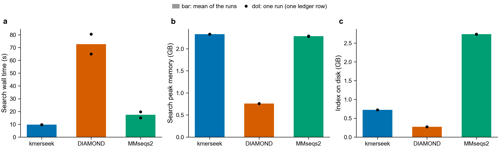

# Speed benchmark: kmerseek, DIAMOND and MMseqs2 on Swiss-Prot

A fixed benchmark, so that later speed work can say whether it helped. Everything below
was measured on Sherlock on 2026-11-01.



Each bar is the mean of the two runs in `ledger.tsv` (git commits bc3348a and f367d3c, Sherlock
jobs 50704775 and 50705684); each dot is one run. Both runs used one Sherlock CPU node,
an AMD EPYC 7742, with 8 threads.

## What is fixed

| What | Value |
|---|---|
| Queries | `queries.fasta`: 1,000 Swiss-Prot proteins, md5 `a4f84f1f590c917616982eef85435b85`. The same file as notebook 239 in 2024-kmerseek-analysis, drawn with Python `random.seed(0); random.sample(records, 1000)` |
| Target | Swiss-Prot 2026_03, `uniprot_sprot.fasta.gz`, md5 `bc9d398533e6df582b563c6c03093bd0`, 575,748 proteins, 209,017,843 residues |
| kmerseek | `--alphabet hp_lehninger2 --ksize 24 --scaled 10 --extend-mismatch-penalty 2` (extension on, other options at their defaults) |
| DIAMOND 2.2.6 | `makedb -p 8`, then `blastp --sensitive -p 8` |
| MMseqs2 18.8cc5c | `createdb`, `createindex --threads 8`, then `easy-search -s 5.7 --threads 8` |
| Machine | one Sherlock CPU node, 8 CPUs, 180 GB; the node name and CPU model go on every ledger row |
| Threads | 8 for every tool (`RAYON_NUM_THREADS=8` for kmerseek) |

`speed.sh` checks both md5 sums and stops if either differs.

The 13 Sep 2026 run in notebook 239 (kmerseek 437 s and 83 GB, DIAMOND 17 s and 1.2 GB) used
`hp_thomas_dill2`, k=15, on a laptop, with a kmerseek build that was never pushed. Its numbers
cannot be compared with these. The kmerseek setting here was chosen on 2026-11-01.

## How to run

```bash
sbatch bench/speed.sh
```

```bash
INDEX=$SCRATCH/kmerseek-bench/speed_<job>/km.db sbatch bench/profile.sh
```

Run both from the repository root on Sherlock. `speed.sh` builds kmerseek, runs the three
tools, appends one row per tool and step to `ledger.tsv`, and compares kmerseek's hit list
with `baseline_hits.tsv.gz`. `profile.sh` runs the same search under `perf` and heaptrack.
`plot_ledger.py` draws the figure above from `ledger.tsv`.

`ledger.tsv` columns: date, git commit, tool, step, wall time (s), peak resident memory
(GB, 1 GB = 1024³ bytes), index size on disk (bytes), node and CPU, threads.

## Results

| Tool | Index build (s) | Search (s) | Search peak memory (GB) | Index on disk (GB) |
|---|---|---|---|---|
| kmerseek | 91.5, 96.5 | 9.70, 9.66 | 2.33, 2.33 | 0.72 |
| DIAMOND | 3.5, 4.2 | 80.5, 65.0 | 0.76, 0.76 | 0.27 |
| MMseqs2 | 28.4, 22.7 | 19.8, 15.0 | 2.28, 2.29 | 2.74 |

Two runs each, in ledger order. MMseqs2's index time is `createdb` plus `createindex`. The
kmerseek index time includes fitting r_database and K for `--extend-mismatch-penalty 2`.

At this setting kmerseek searches 6.7 to 8.3 times faster than DIAMOND `--sensitive` and
uses 3.1 times its peak memory.

## Correctness gate

`baseline_hits.tsv.gz` holds kmerseek's 276,930 regions from run bc3348a: query, target,
query region start and end, target region start and end, and the region's shared k-mer
count, sorted bytewise. `speed.sh` writes the same file for every run and compares it byte
for byte. The second run, on unchanged search code, printed `HITS IDENTICAL`.

## Where the search time goes

The hot path is Rust. `profile.sh` sampled the search 999 times a second per thread
(`perf record --call-graph dwarf`), giving 11.6 CPU-seconds of samples.
`baseline_flame.svg` is the flame graph. Functions with the most self time, from
`profile/perf_self.txt`, with the kmerseek function each is called from:

| Self time | Function | Mostly called from |
|---|---|---|
| 24.7% | kernel (no symbols: `perf_event_paranoid` is 2 on Sherlock) | memory mapping (`mprotect`), reading signatures |
| 8.3% | `BuildHasher::hash_one`, Rust's default SipHash | `ProteinSearcher::compare`, `encode_residue`, `multi_reading_windows` |
| 5.0% | `_int_malloc` | `get_signature_by_md5`, `ProteinSketch::from_efficient_data` |
| 4.2% | `snappy::DecompressBranchless` | RocksDB reading signature blocks |
| 3.6% | `_int_free` | dropping `ProteinSketchStore` and cached sketches |

Counted with everything they call, `ProteinSearcher::compare` takes 36% of the samples,
`get_signature_by_md5` 14%, and dropping the `ProteinSearcher` at exit 6%.

## Where the memory goes

Peak resident memory is 2.33 GB. Read from `/proc` every 0.1 s during the search
(`profile/rss_split.txt`), 1.87 GB of it is anonymous memory (heap and stacks) and 0.46 GB is
mapped files.

heaptrack counts only 313 MB of live heap at the peak, and under heaptrack the whole search
peaks at 468 MB resident. So about 1.5 GB of the anonymous memory is not held by any live
allocation. This was not tested further. The five allocation sites holding the most heap at
the peak, from `profile/heaptrack_peaks.txt`:

| Heap at peak | Allocations | Site |
|---|---|---|
| 75.2 MB | 1,701 | `load_search_cache`: the inverted index's hash table |
| 66.1 MB | 1,673,164 | `load_search_cache`: one posting list per indexed k-mer |
| 35.7 MB | 1 | `ProteinSearcher::from_cache`: a hash map built by `collect` |
| 35.7 MB | 1 | `load_search_cache`: a second hash table |
| 35.1 MB | 6,396 | `Vec::with_capacity` in signature buffers (`main`, `get_signature_by_md5`) |

## Notes

- The search loads 443,907 targets though Swiss-Prot has 575,748 records. 88,272 records repeat
  an earlier record's sequence exactly, leaving 487,476 distinct sequences. 3,535 of those are
  shorter than 24 residues. If each 24-mer were kept with chance 1/10 independently, about
  5,700 more would keep none, and in a two-letter alphabet repeated 24-mers within a protein
  make that number larger.
- DIAMOND took 17 s on the laptop (Apple M4 Max) and 65 to 80 s here. Compare tools only
  within one node type.
- The index size on disk varies by a few hundred bytes between runs (RocksDB's own files).
