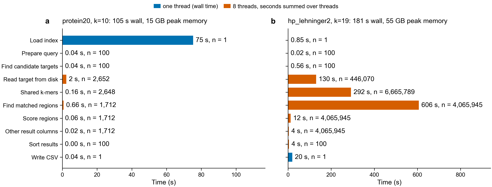
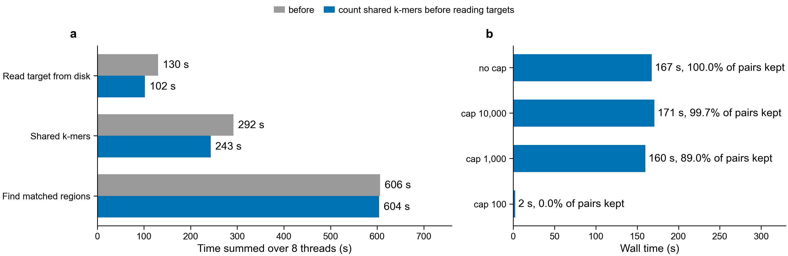

# Where a search spends its time (Swiss-Prot, October 2026)

100 human proteins searched against all of Swiss-Prot (575,748 proteins, 209 million
residues), on one Sherlock node with 8 threads, at commit 07b7244. Every step's seconds
come from the timers kmerseek turns on when `KMERSEEK_PROFILE` is set. Steps that run on
8 threads at once (orange) are summed over the threads, so they add up to more than the
wall time. Bars are the mean of two runs with the timers on.

| Index | Wall time | Peak memory | Candidate targets per query | Results kept |
|---|---|---|---|---|
| protein20, k=10 | 105 s | 15 GB | 27 | 1,712 |
| hp_lehninger2, k=19 | 181 s | 55 GB | 66,658 (11.6% of Swiss-Prot) | 4,065,945 |

## protein20, k=10: loading the index is 72% of the run

Loading the index takes 75 s of the 105 s wall time. The index holds 117 million different
k-mers, and `load_search_cache` reads every one of them into an in-memory `HashMap` before
the first query starts. The 100 queries themselves take 3.3 thread-seconds, about 0.4 s of
wall time on 8 threads. The search would be about 3 times faster with an index that is
read from disk as needed (sorted k-mers in a memory-mapped file) instead of rebuilt in memory
on every run.

## hp_lehninger2, k=19: too many candidates

With two letters and k=19 there are only 2^19 = 524,288 possible k-mers. The Swiss-Prot
index holds 572,309 different hashes; the extra ones presumably contain letters outside the
two classes, which was not checked. Each query k-mer therefore points at many
proteins: one query has on average 66,658 candidate targets, and 61% of those pass the
default filters and become results (6.5 million CSV rows). The time follows the number of
candidates:

- finding matched regions: 606 thread-seconds, 58% of the search work;
- the shared k-mers between query and target: 292 thread-seconds, 28%;
- reading targets from RocksDB: 130 thread-seconds, 12%. 446,070 different targets were
  read, 77% of Swiss-Prot. All of them stay in the in-memory cache, which is why the run
  peaks at 55 GB.

Finding the candidates in the inverted index takes only 0.6 s. What would help is fewer
candidates reaching the per-target steps: a cap on k-mers that occur in too many proteins,
or requiring two shared k-mers on the same diagonal (target position minus query position)
before a target is read from disk.

## What the timers do not cover

About 29 s of each run's wall time is outside every timer, in both settings. That is the
wall time minus loading, writing the CSV, and the parallel steps divided by 8. Freeing the
index and cache at exit is a likely place, but this was not measured.

The timers themselves cost nothing measurable: runs with them off took 104 s and 191 s,
runs with them on 105-107 s and 175-177 s. The first run of each setting (140 s and 466 s)
read the index from a cold disk cache and is left out of the means.

## Files

- `timing.tsv`: wall time, CPU time, peak memory and CSV rows for every run.
- `steps.tsv`: seconds and number of calls per step, for the runs with timers on.
- `commit.txt`, `inputs.md5`: the kmerseek commit and the md5 of Swiss-Prot and the queries.
- Rerun on Sherlock: `sbatch scripts/profile_search_steps.sbatch`; redraw:
  `python scripts/plot_search_profile.py`.

# Filtering candidates before reading targets (hp_lehninger2, k=19)

Commit fa352ce counts each candidate's shared k-mers from the posting lists. It drops
candidates below `--min-shared-kmers` (2 by default) or the containment threshold before
their signature is read from disk. A posting list names each target once, so the count is
exactly the number `compare` checks later. The search results do not change: the CSVs are
byte-identical to the runs above (`candidate_filter/identical.md5`).

- Targets compared per query fell from 66,658 to 40,659. The 39% dropped shared only one k-mer.
- Time spent on shared k-mers fell from 292 to 243 thread-seconds, and reading targets from
  130 to 102. Target reads fell only from 446,070 to 435,401, because most dropped targets
  are still read for another query.
- Finding matched regions is unchanged at 604 thread-seconds: every pair that reaches it
  was going to be a result.
- Wall time went from 181 s to 167 s (8% faster); CPU time from 1,012 s to 952 s.

`--max-kmer-targets N` (off by default) keeps a pair only if it shares at least one k-mer
found in no more than N targets. On this index it does not pay:

| Cap | Wall time | Pairs kept | Top 1% of pairs by region score kept |
|---|---|---|---|
| none | 167 s | 4,065,945 (100%) | 100% |
| 10,000 | 171 s | 99.7% | 100% |
| 1,000 | 160 s | 89.0% | 98.8% |
| 100 | 2 s | 0 | 0 |

A cap of 100 leaves nothing because every k-mer of these 100 queries occurs in more than 100
Swiss-Prot proteins. With 2^19 possible k-mers and 209 million residues, no hp_lehninger2
k=19 k-mer is rare. A cap of 1,000 costs 11% of the pairs for 4% less time.

The work is per pair, and the 4 million pairs pass the default filter of two shared k-mers.
In an alphabet this small, two shared k-mers are expected by chance alone. Two changes could
cut the pairs:

- a default minimum that grows with the number of k-mers two random proteins would share;
- storing each k-mer's position in the posting lists, so pairs whose shared k-mers do not lie
  on one diagonal can be dropped before the target is read. This changes the index format.

Both change which results are reported, so neither is in this PR. Rerun with
`sbatch scripts/profile_candidate_filter.sbatch` and redraw with
`python scripts/plot_candidate_filter.py`.
