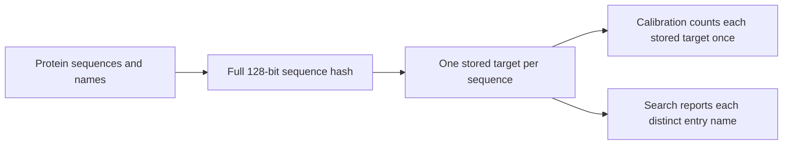

# Sequence identity and repeated entry names

Different sequences can contain the same set of k-mers. Each needs its own stored
sequence so that reported residues and coordinates come from the correct protein.
Identical sequences share one stored target. Their different names remain available
in search output.

## Decisions from PR 152

- Count distinct stored sequences in database size, calibration and statistical
  corrections. Repeating a name or adding another name does not add an independent
  comparison. Reported rows can therefore outnumber the comparisons counted.
- Keep one output row per entry name. This costs memory proportional to the number
  of reported names and their regions. It preserves the existing output format.
- Store each additional name in its own `alias_<key>_<name>` database record.
  Hash sets check whether a name is already present. Adding names no longer scans
  or serializes an ever-growing list. RocksDB still has its own write and compaction
  costs; this is not a claim of constant total disk-write time.
- Keep the alias map in `ProteomeIndex`. Search asks that owner for each target's
  names, sorted for deterministic output. Opening for search loads the map once;
  explicitly reloading the index refreshes it from disk.
- Read the primary name from a small `name_<key>` record when ingesting a duplicate
  from an earlier batch. Do not deserialize the full protein sketch for its name.
- Stage signature records, alias records, target chunks and posting runs in one
  database batch. Update in-memory state and retained signatures only after the
  write succeeds. Staging copies the bounded posting and target buffers and holds
  the current batch's writes; it does not clone the complete index.
- Require a sequence key in both storage constructors and reject malformed keys
  when loading a stored sketch. Reject a second sequence added to the same sketch
  before modifying its k-mers or coordinates.
- Retain both halves of MurmurHash3's 128-bit result. A collision in the former
  64-bit half can now retain both targets. A collision in the full 128-bit hash is
  still possible: this is not an exact residue-equality check. The old half stays
  first to preserve sorting unless old keys collide or one is a prefix of another.

## BLAST and Foldseek comparison

BLAST's E-value depends on database size. Its documentation describes the expected
number of chance matches in a database of the same size; it does not prescribe
kmerseek's shuffled-region calibration. See the [NCBI explanation of E-values](https://www.nlm.nih.gov/ncbi/workshops/2023-08_BLAST_evol/e_value.html).

Foldseek's structure alignment code passes the target database's amino-acid count
to its E-value model. The model uses that count in its E-value calculation.
See [the alignment caller](https://github.com/steineggerlab/foldseek/blob/463739e0014a1549a527de589102cde98f802f37/src/strucclustutils/structurealign.cpp#L290)
and [the E-value calculation](https://github.com/steineggerlab/foldseek/blob/463739e0014a1549a527de589102cde98f802f37/src/strucclustutils/EvalueNeuralNet.h#L35).
These sources do not establish that arbitrary input databases are automatically
deduplicated. For kmerseek, the chosen search database consists of distinct stored
sequences, so both calibration and database-size correction use those sequences.
Additional names are labels on the same comparisons.

## Release note for 0.4.0

Index targets by the full sequence hash instead of the set of k-mers. Preserve
additional names for identical sequences, without counting those names again in
calibration. Store names individually and commit each ingest batch atomically.
Schema 6 changes sequence keys and alias storage. Rebuild older indexes, including
schema 5 indexes from earlier versions of this PR. The existing CSV field names
containing `md5` are retained for compatibility; their values are sequence hashes.

The existing self-match rule remains: a query identical to a stored target is
skipped, including that target's aliases. All-vs-all searches still use each stored
sequence once as a query. Changing those policies is separate from keeping two
*different* sequences whose former keys collided.

## Verification

Regression tests cover separate targets with equal simulated 64-bit hash halves.
They also cover 1,000 names stored as 999 individual alias records, repeated ingestion,
and reopening. Failure tests exercise a late batch-validation error followed by retry
and a write to a read-only database.
Sketch tests cover both hash halves, loading without stored residues, rejecting an
empty key, and rejecting a second sequence without modifying the first sketch.

Validation on 2026-10-30, after merging current `main`:

- Built the CLI executable before testing, so CLI tests used this branch's binary.
- `cargo test --no-default-features -- --test-threads=1`: 340 unit tests and nine
  documentation tests passed. Existing calibration expectations were unchanged.
- `cargo fmt --check`, whitespace checks on the changed Rust and review-document files, and
  `cargo clippy --no-default-features --all-targets -- -D warnings` passed.
- An earlier test run aborted during a CLI assertion while the shared target
  directory held another executable. Rebuilding the CLI made that test and the
  complete suite pass. The native RocksDB archive built during this session was
  reused for subsequent builds.
- No large-database performance benchmark or Sherlock run was performed. The alias
  test verifies bounded record sizes, not a measured end-to-end speedup.
